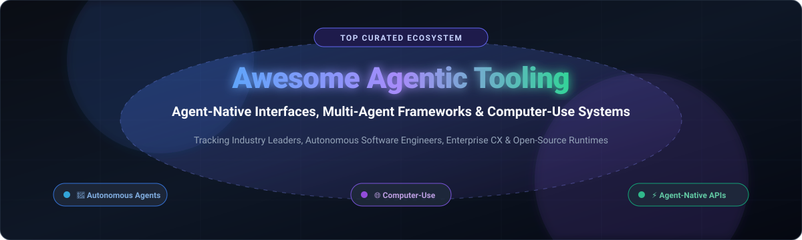

# ⚡ Awesome Agentic Tooling & Interfaces 🤖

**A Curated Index of SaaS Platforms, Open-Source Runtimes, Computer-Use Agents & Agentic Tooling Frameworks**

*Track autonomous software engineers, multi-agent orchestrators, computer-use tooling, and agent-native CLI/API protocols.*

[**Explore SaaS Platforms**](#-saas-products) • [**Explore Open-Source Tools**](#-open-source-github-projects) • [**Market Dynamics**](#-sector-overview--market-dynamics) • [**Contributing**](#-how-to-contribute) • [**Support**](#-support)

---

## 🧭 Overview

Welcome to **Awesome-Agentic-Tooling-Interfaces**! This repository tracks industry-leading **SaaS platforms** and high-velocity **open-source frameworks** designed for **Agentic AI, Tool-Using Agents, Multi-Agent Orchestration, and Computer-Use Systems**.

As AI transitions from static chat completions to proactive autonomous agents, systems must interface seamlessly with software environments—using command lines, executing APIs, driving headless browsers, and collaborating across heterogeneous teams of subagents.

### 🔍 Key Areas Covered
* 🛠️ **Agent-Native Tooling**: Tool-calling specifications, Model Context Protocol (MCP), and structured CLI synthesizers.
* 🌐 **Computer-Use & Browser Automation**: Autonomous web-browsing agents and vision-based desktop operators.
* 👥 **Multi-Agent Orchestration**: Graph-based state machines, role-driven agent teams, and supervisory coordination.
* 💻 **Autonomous Software Engineering**: Sandboxed coding agents, autonomous pull-request resolvers, and debugging copilots.
* 🏢 **Enterprise Customer-Facing Agents**: Outcome-based resolution systems for large-scale customer operations.

---

## 📑 Table of Contents

- [📊 Sector Overview & Market Dynamics](#-sector-overview--market-dynamics)
- [☁️ SaaS Products](#️-saas-products)
- [🐙 Open-Source GitHub Projects](#-open-source-github-projects)
- [🏗️ Key Open-Source Architectures](#️-key-open-source-architectures)
- [📈 Star History](#-star-history)
- [🤝 How to Contribute](#-how-to-contribute)
- [💖 Support](#-support)
- [⚠️ Disclaimer](#️-disclaimer)

---

## 📊 Sector Overview & Market Dynamics

The global AI Agents & Agentic Tooling market is valued at approximately **$9.8B to $11.5B in 2026** (scaling exponentially at a ~40–47% CAGR from ~$5.2B in 2024 toward over $100B by the early 2030s). The market structure exhibits a dual dynamic: it is **highly concentrated at the foundation model and compute infrastructure layer** (dominated by hyperscalers like Microsoft, OpenAI, Google, and Amazon), while being **moderately to highly fragmented at the vertical application and agent-tooling layer**, where agile startups and specialized frameworks compete across bespoke enterprise workflows, customer support, and developer automation.

---

## ☁️ SaaS Products

A curated comparison of commercial platforms offering autonomous agents, hosted sandboxes, and enterprise agentic tooling.

| Product | Scale (Valuation / Revenue) | Description | Starting Pricing | Free Tier Limits |
| :--- | :--- | :--- | :--- | :--- |
| **[Cognition Devin](https://www.cognition.ai/)** | 💰 $48B valuation (~$1B ARR) | 🧑‍💻 Autonomous AI software engineer that plans, codes, and debugs in cloud sandboxes. | $20/month (Pro plan) | Free forever tier with light included quota and limited model access. |
| **[Sierra AI](https://sierra.ai/)** | 💰 $15.8B valuation (>$200M ARR) | 💬 Enterprise-grade conversational AI platform providing brand-aligned customer agents. | ~$150,000/year (Outcome-based per resolution + platform fee) | 14-day guided proof-of-concept / sandbox trial for qualified enterprises (no permanent free tier). |
| **[Zapier Central](https://zapier.com/central)** | 💰 $5.0B valuation (~$400M ARR) | 🔌 Agentic workflow automation layer connecting natural-language prompts with 7,000+ app APIs. | $19.99/month (Starter plan billed annually) | Free forever plan with 100 tasks/month, 2-step Zaps, and basic AI copilot features. |
| **[Decagon](https://www.decagon.ai/)** | 💰 $4.5B valuation (>$100M ARR) | 🎧 Enterprise AI agent platform for high-volume customer service operations. | ~$50,000/year baseline ($0.50–$1.50 per conversation / resolution) | 14-day enterprise pilot trial for evaluated corporate accounts (no permanent free tier). |
| **[Adept](https://www.adept.ai/)** | 💰 $1.0B valuation ($415M+ raised; Amazon-licensed) | 🖱️ Pioneer in action-oriented foundational agent models operating across browser and desktop UIs. | Private enterprise licensing agreements | Closed enterprise developer beta / trial upon direct demo request (no open public tier). |
| **[Lindy AI](https://www.lindy.ai/)** | 💰 $225M+ private valuation ($50M raised) | 👔 Low-code platform creating autonomous AI digital employees for email, scheduling, and CRM workflows. | $29.99/user/month (Plus plan with 3,000 credits) | 7-day free trial with introductory testing credits (no permanent free tier). |
| **[MultiOn](https://multion.ai/)** | 💰 $100M valuation ($20M raised) | 🌐 Web-browsing and device-control agent executing complex multi-step browser actions autonomously. | $25/month (Pro plan) | Free forever plan with up to 10 automated tasks/day via Chrome extension. |
| **[CrewAI (Enterprise)](https://www.crewai.com/)** | 💰 ~$100M valuation ($18M raised) | 🏢 Managed platform and enterprise orchestration control plane for multi-agent teams. | $60,000/year (Enterprise AMP tier) | Free forever plan with visual editor, GitHub integration, and 50 workflow executions/month. |
| **[Fixie.ai](https://fixie.ai/)** | 💰 $51.5M valuation ($17M raised; acquired by Inworld) | 🎙️ Real-time voice and multi-modal conversational AI agent platform (Ultravox.ai engine). | $100/month (Pro plan) | Free forever tier with 30 free minutes/month and up to 5 concurrent real-time calls. |
| **[HyperWrite](https://www.hyperwriteai.com/)** | 💰 ~$4.2M ARR ($2.8M raised) | ✍️ AI writing and browser automation assistant executing interactive web tasks. | $19.99/month (Premium plan) | Free forever plan with limited monthly AI messages/credits and basic TypeAhead suggestions. |

---

## 🐙 Open-Source GitHub Projects

Explore the top open-source repositories powering the modern agentic ecosystem, sorted by GitHub_Stars.

| Project | GitHub_Stars | Description |
| :--- | :--- | :--- |
| **[AutoGPT](https://github.com/Significant-Gravitas/AutoGPT)** |  | 🤖 Pioneer autonomous open-source agent framework driven by goal decomposition and continuous execution loops. |
| **[Browser-use](https://github.com/browser-use/browser-use)** |  | 🌐 Open-source library enabling AI agents to interactively control web browsers for scraping, forms, and workflows. |
| **[Model Context Protocol (MCP)](https://github.com/modelcontextprotocol/servers)** |  | 🔌 Anthropic-originated open standard and reference server collection connecting AI agents directly to tools, APIs, and data sources. |
| **[OpenHands](https://github.com/All-Hands-AI/OpenHands)** |  | 💻 Open-source autonomous software development agent operating directly inside terminals, code editors, and browsers. |
| **[MetaGPT](https://github.com/FoundationAgents/MetaGPT)** |  | 🏢 Multi-agent collaboration framework encoding Standard Operating Procedures (SOPs) into specialized software roles. |
| **[AutoGen](https://github.com/microsoft/autogen)** |  | 🗣️ Multi-agent conversational framework enabling expressive multi-actor coordination and human-in-the-loop patterns. |
| **[CrewAI](https://github.com/crewAIInc/crewAI)** |  | 👥 Popular framework for orchestrating collaborative teams of autonomous AI agents with designated roles, goals, and tooling. |
| **[CLI-Anything](https://github.com/HKUDS/CLI-Anything)** |  | ⌨️ Framework turning standard desktop, web, and API software into agent-native structured CLIs with automatic tool generation and CLI-Hub. |
| **[LlamaIndex Workflows](https://github.com/run-llama/llama_index)** |  | 🗂️ Production-grade data and retrieval-augmented agent orchestration framework with event-driven execution loops. |
| **[LangGraph](https://github.com/langchain-ai/langgraph)** |  | 🕸️ Graph-based orchestration library designed for cyclical, stateful, and long-running multi-agent systems with built-in persistence. |
| **[smolagents](https://github.com/huggingface/smolagents)** |  | ⚡ Hugging Face's lightweight, code-first agent framework emphasizing simplicity, direct tool execution, and speed. |
| **[BabyAGI](https://github.com/yoheinakajima/babyagi)** |  | 👶 Minimalist benchmark AI task management system utilizing OpenAI and vector databases to prioritize and execute tasks. |
| **[Microsoft Agent Framework](https://github.com/microsoft/agent-framework)** |  | 🪟 Microsoft's enterprise-grade multi-language runtime unifying AutoGen and Semantic Kernel patterns for scalable agent systems. |

---

## 🏗️ Key Open-Source Architectures

* ⌨️ **Tool Virtualization & CLI Synthesizers**: Using **CLI-Anything** to bridge existing CLI/GUI applications into clean agent tool calling interfaces without rearchitecting legacy systems.
* 🔌 **Protocol Standards**: Adopting **Model Context Protocol (MCP)** for interoperable, secure tool, resource, and prompt sharing across client agents.
* 🕸️ **Stateful Multi-Agent Orchestration**: Leveraging **LangGraph** or **CrewAI** to manage state machines, human approval checkpoints, and task delegations across agent teams.
* 🌐 **Computer-Use & Browser Automation**: Employing **Browser-use** for direct visual/DOM interaction with SaaS applications lacking public APIs.
* 💻 **Autonomous Coding Stacks**: Running **OpenHands** or **AutoGPT** for sandboxed, self-healing software development loops.

---

## 📈 Star History

---

## 🤝 How to Contribute

Contributions are warmly welcome! To add or update an entry:

1. 🍴 Fork this repository.
2. 📝 Edit `README.md` following the existing tabular structure.
3. 🔗 Ensure all links are official and descriptions are concise, factual, and neutral.
4. 🚀 Submit a Pull Request with a clear description of your additions.

---

## 💖 Support

Thank you for visiting and supporting the **Awesome Agentic Tooling & Interfaces** project! 🌟

If you find this curated ecosystem helpful, please consider:
- ⭐ **Starring** this repository on GitHub
- 🍴 **Forking** and contributing new agentic tools
- 📢 **Sharing** with your fellow AI engineers, builders, and community
- ☕ **Buying a coffee / Sponsoring** the maintainer via the [GitHub Sponsors Dashboard](https://github.com/sponsors/ishandutta2007)

---

## ⚠️ Disclaimer

- This repository is a **community-curated index** for informational and research purposes only; inclusion does not constitute an endorsement.
- Agentic systems execute real actions (e.g., code execution, purchases, communications, browser manipulations). Always utilize isolated sandboxes, explicit permission layers, and human oversight.

---

Made with ❤️ for AI engineers, autonomous agent developers, and open-tooling advocates.

